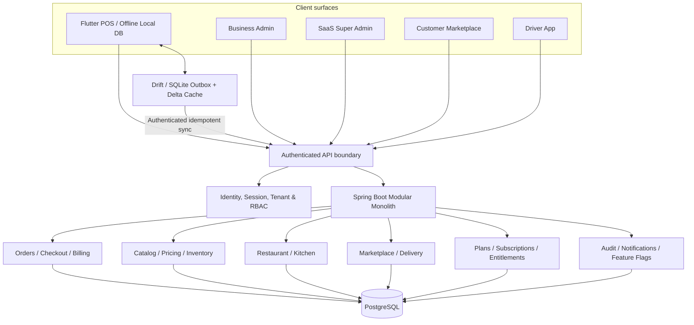
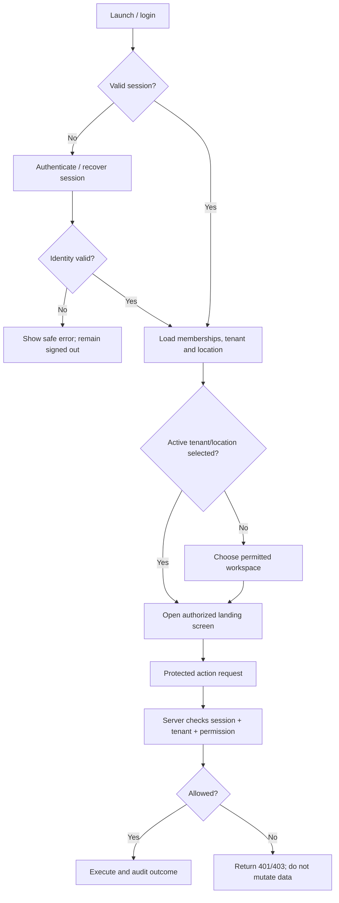
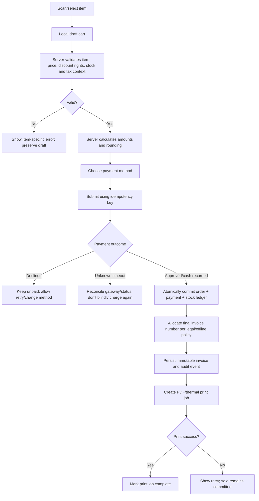
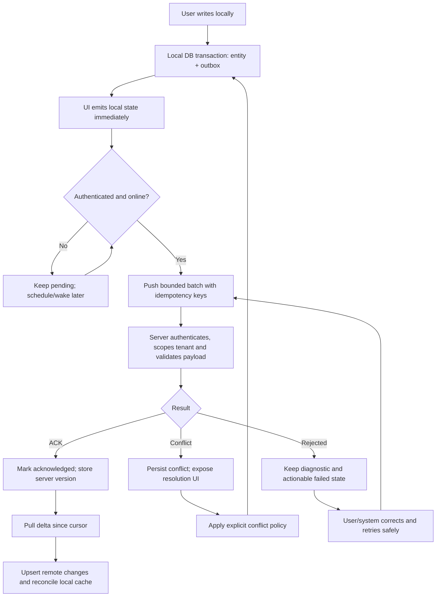
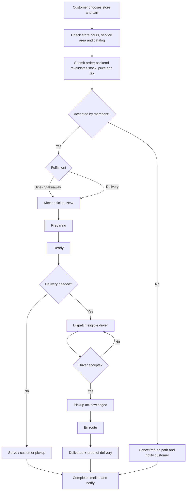
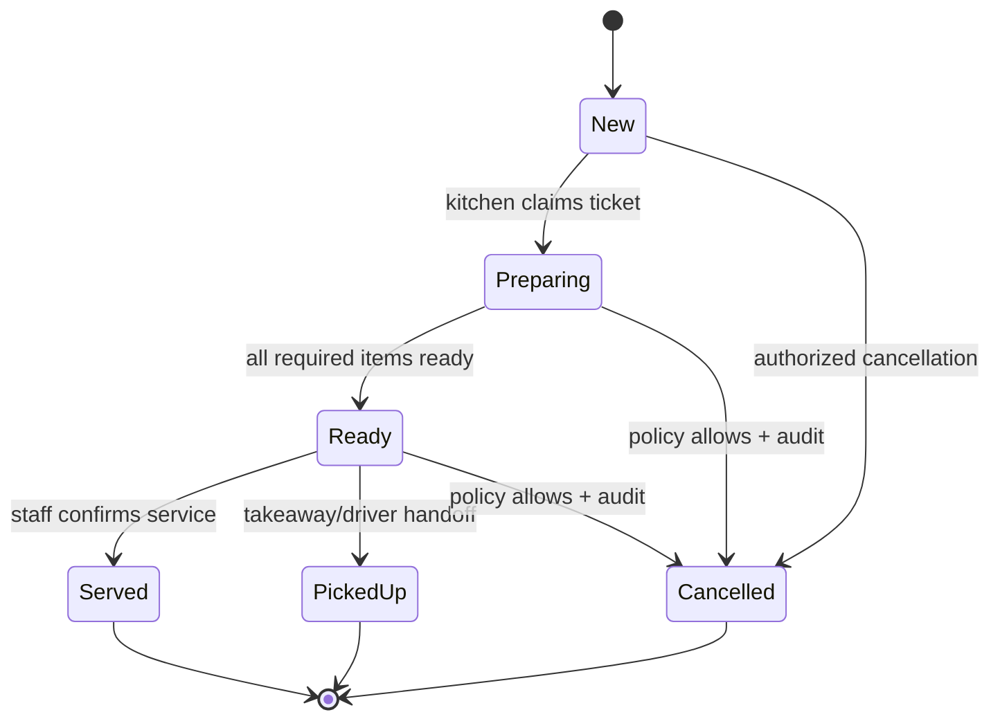
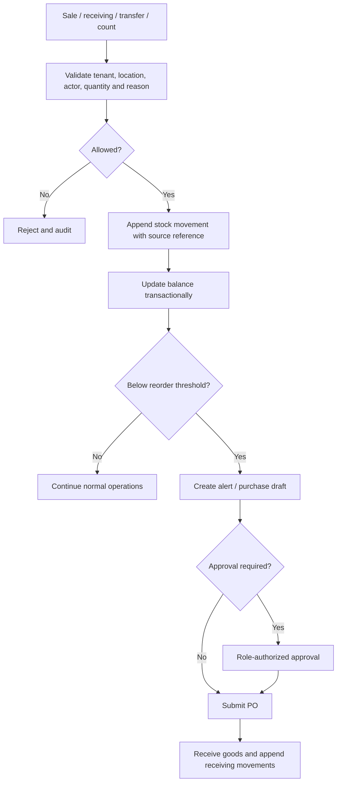
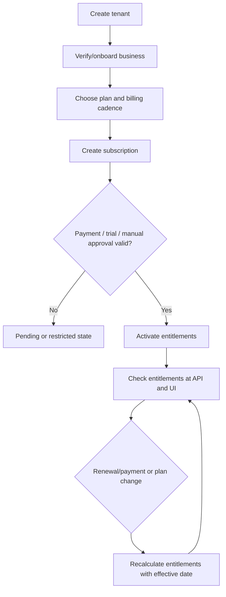
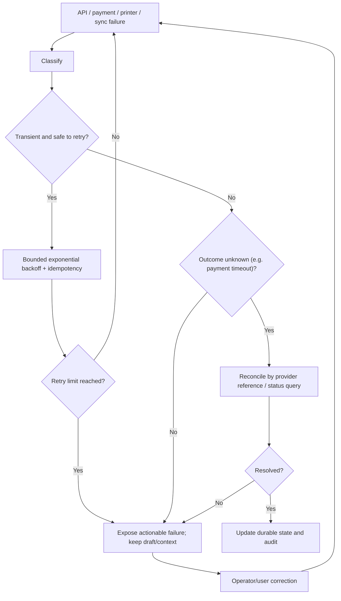

# Vyavsetu Architecture & Business Flowcharts

These are proposed production workflows, not implemented backend behaviour. Mermaid diagrams display in GitHub Markdown.

## 1. High-level platform architecture

## 2. Login, tenant selection and authorization

**Conditions:** client UI guards are for usability only; every server mutation must enforce the same rules. Expired session or revoked membership must stop protected sync and queue drains.

## 3. POS checkout and invoice finalization

**Invariants:** payment, inventory movement and order commit must not be duplicated by retries. Printing failure must not roll back a successful sale. Provisional bill and final invoice must remain distinct.

## 4. Offline outbox / sync lifecycle

**Required states:** pending, syncing, synced, retryable failure, permanent failure and conflict. Never block the first local render on bootstrap/pull completion.

## 5. Marketplace order to kitchen and delivery

**Conditions:** cancel/refund depends on fulfilment/payment state; do not permit arbitrary state jumps. Store transitions should carry actor, timestamps and idempotency keys.

## 6. Restaurant KDS state machine

Reject stale/duplicate transitions with a conflict response instead of silently overwriting a newer state.

## 7. Inventory ledger and purchasing

**Conditions:** choose and document whether reservation or sale commit decrements available stock. Multi-terminal and offline sales need explicit oversell/conflict policy; do not silently replace counts.

## 8. Tenant plans and entitlements

Entitlements must be checked server-side and cached client-side only for navigation/experience. Keep historical subscription events and audit changes.

## 9. Failure classification and recovery

## 10. Demo versus production

| Capability | Current prototype | Production requirement |
|---|---|---|
| Screens/theme/device preview | Included, sample UI | Real adaptive Flutter UI, accessibility QA |
| Developer handoff | Brand tokens and flow descriptions | Versioned source-of-truth design/docs tied to API contracts |
| Identity/RBAC | Illustrative only | Server-side authZ and tenant isolation tests |
| Payment/tax/invoice | Illustrative totals only | Gateway, legal tax rules, immutable invoice lifecycle |
| Offline sync | Not implemented | Drift, outbox, idempotent API, conflicts and migrations |
| Inventory/orders | Sample data only | PostgreSQL transactions and ledger invariants |
| Printing/drawer | Not implemented | Tested ESC/POS/platform drivers and job state |
| CI/deployment | GitHub Pages workflow configured | Confirm Pages settings and passing workflow; separate build/test pipelines |
